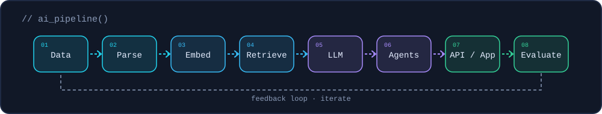
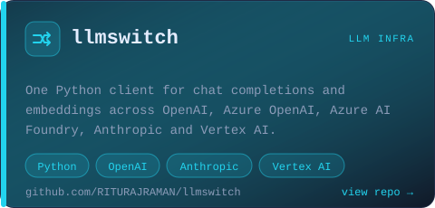
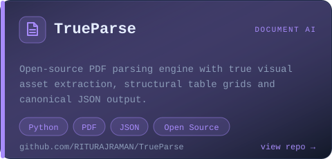
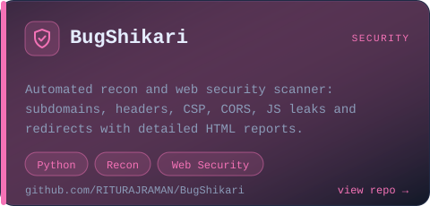
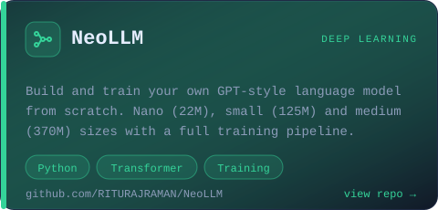
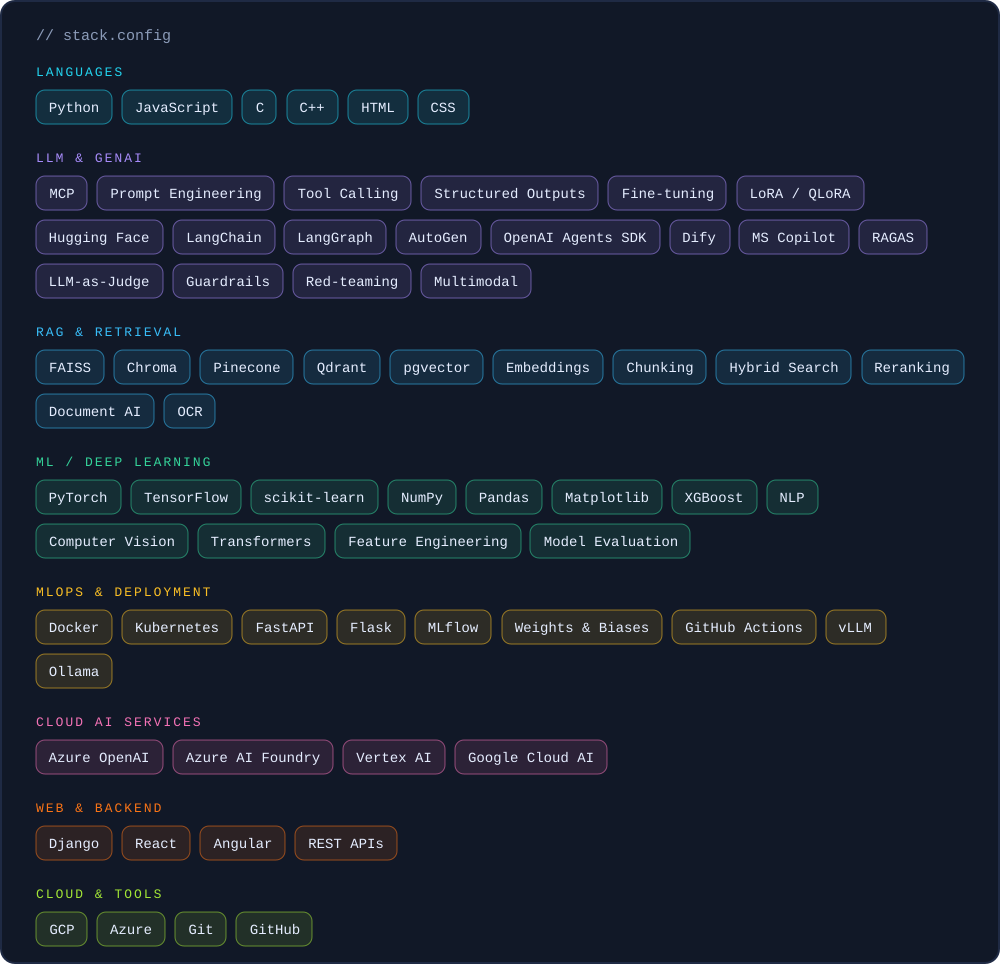
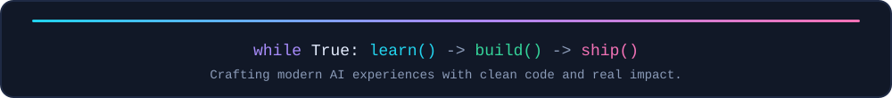

  

 

 

## 🧬 How I Build AI Systems

 

## 🚀 Featured Projects

<b>More projects</b>

 

- [Breast_Cancer_Detection_Project](https://github.com/RITURAJRAMAN/Breast_Cancer_Detection_Project): breast cancer detection using ML algorithms
- [House_Price_Prediction_System](https://github.com/RITURAJRAMAN/House_Price_Prediction_System): ML web app that predicts house prices
- [E_Commerce_Web_App-.Net](https://github.com/RITURAJRAMAN/E_Commerce_Web_App-.Net): e-commerce app with a .NET API
- [My-Profile](https://github.com/RITURAJRAMAN/My-Profile): personal portfolio website

 

## 🧰 Tech Stack

 

## 📊 Skill Matrix

 

